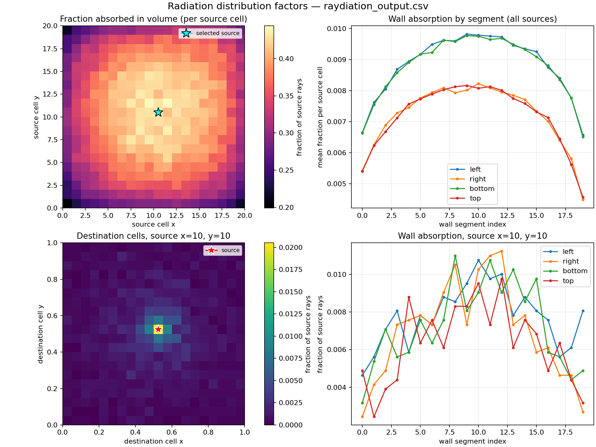
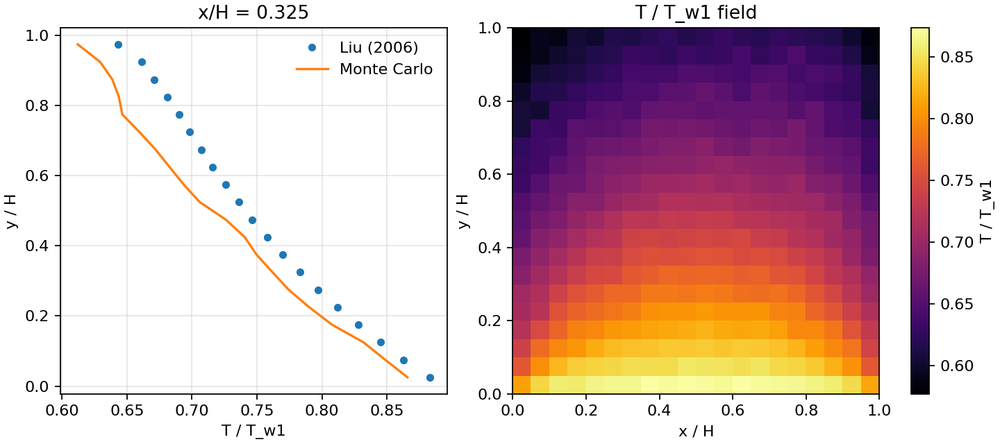
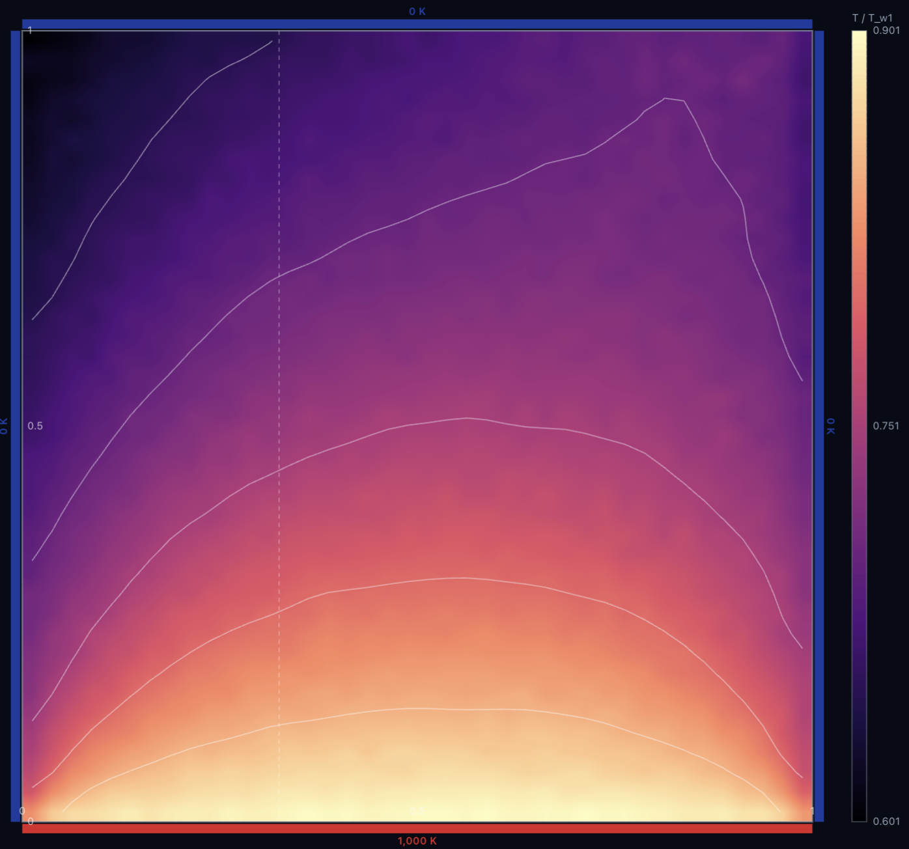

# Raydiation

**Raydiation** *(ray tracing + radiation)* is a CUDA Monte Carlo ray tracer for
radiative heat transfer in graded-index media.

The unit square is split into an `n x n` grid of volume cells. Every cell emits
the same number of rays, and each GPU thread traces rays until they are absorbed
in a volume cell or on a wall. The result is a source-to-destination radiation
distribution factor matrix.

## Method

- 2-D graded-index medium: `n(x,y) = n_ref * sqrt(1 - a2 * (x² + y²))`
  with `n_ref = 5`, `a2 = 0.4356`.
- RK4 ray integration in the optical variable `t = ∫ ds / n`.
- The adaptive rk4 kernel uses one full step versus two
  half steps to estimate the local error.
- Black walls by default, the hot wall is the bottom wall at 1000 K.
- Jacobi solve for the radiative-equilibrium temperature field
  `u = T⁴ / T_hot⁴`.

## Outputs

- `results/raydiation_output.csv`: radiation distribution factors.
  `r[s][d]` is the fraction of rays from source cell `s` absorbed at
  destination `d`.
- `results/temperature_field.csv`: cell-centred `T/T_w1` and `T` in kelvin.

## Build and run

```sh
make
./raytrace
```

On AQUA, use CUDA 12.2 and GCC 12.1:

```sh
make \
  NVCC="/lfs/sware/cuda-12.2/bin/nvcc -ccbin /lfs/sware/gcc12.1.0/bin/g++" \
  NVCCFLAGS="-O3 -std=c++17" \
  ARCH=sm_70
```

Run the full GPU job and validation checks with:

```sh
qsub aqua/run.pbs
```

## Visualisation

```sh
python3 visualize.py                 # distribution-factor summary
python3 visualize.py --temperature   # profile vs Liu (2006) + T field
```





## Performance

Kernel-only medians on AQUA Tesla V100-PCIE-32GB, CUDA 12.2:

| workload | fixed | adaptive | speedup |
|---|---:|---:|---:|
| 20×20, 4096 rays/cell | 14.485 ms | 4.244 ms | 3.41× |
| 20×20, 40960 rays/cell | 143.707 ms | 40.815 ms | 3.52× |
| 40×40, 4096 rays/cell | 57.769 ms | 16.486 ms | 3.50× |
| 100×100, 4096 rays/cell | 361.382 ms | 99.139 ms | 3.65× |
| 100×100, 16384 rays/cell | 1440.175 ms | 390.556 ms | 3.69× |

The adaptive RK4 optimization is 3.4–3.7× faster than the fixed-step v1. The speedup grows with workload because setup costs are amortised. Fixed throughput is about 113 Mrays/s and adaptive throughput is 386–420 Mrays/s.

The adaptive RK4 kernel uses 1.5× more registers than the fixed-step kernel, which reduces occupancy to 0.75×. The adaptive kernel is also more divergent, but the speedup is dominated by fewer RK4 steps per ray.



LLM Usage: The visualization and benchmarking scripts were generated with the help of an LLM.

## Reference

Jiang Shao, Keyong Zhu, Yong Huang,
*[A fast GPU Monte Carlo implementation for radiative heat transfer in
graded-index media](https://doi.org/10.1016/j.jqsrt.2021.107680)*,
Journal of Quantitative Spectroscopy and Radiative Transfer.
